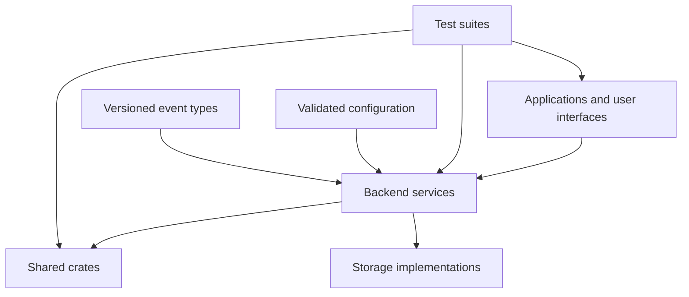

# Directory Structure

> **Status:** Proposed initial layout; subject to architecture and security review.  
> **Primary language:** Rust  
> **Web interface candidate:** Leptos  
> **Initial deployment:** One host with 64 GB RAM, with logical separation between services.  
> **Purpose:** Define the intended repository layout and the responsibility of each area.

This document describes the planned structure of the Private and Secure Git Platform repository. It is a design guide, not a claim that all directories, services, or features already exist.

**Create directories and workspace members when implementation begins. Do not create empty placeholders merely to match this tree.** Start with a small, buildable workspace and introduce additional processes only when a clear security, reliability, or operational boundary justifies them.

## 1. Design rules

1. **Rust first:** use Rust for backend services and project-specific logic wherever practical.
2. **Explicit boundaries:** public UI, privileged administration, recovery, AI analysis, Sentinel, and containment must not share unrestricted privileges.
3. **A directory is not automatically a process:** code may initially be organized as libraries or modules and separated into processes when justified.
4. **Acyclic dependencies:** shared crates must not depend on application binaries or create circular dependencies.
5. **No repository-code execution on the host:** Git operations must treat repository content as untrusted data. Any future CI runner requires a separately designed sandbox.
6. **No secrets in source control:** examples may contain placeholders, never production secrets, private keys, recovery codes, or real onion-service credentials.
7. **Test recovery as well as prevention:** security and containment tests must verify that essential monitoring, logs, and recovery paths remain available.
8. **Document real behavior:** update architecture and operations documentation whenever service boundaries, permissions, or recovery behavior change.

## 2. Proposed repository tree

```text
KyptosTesMoiras/
├── ReadMe.md
├── DirectoryStructure.md
├── License
├── Contributing.md
├── Security.md
├── .gitignore
├── rust-toolchain.toml
├── Cargo.toml
├── Cargo.lock
│
├── docs/
│   ├── architecture/
│   │   ├── overview.md
│   │   ├── trust-boundaries.md
│   │   ├── service-interfaces.md
│   │   ├── resource-pools.md
│   │   └── data-flows.md
│   ├── security/
│   │   ├── threat-model.md
│   │   ├── permissions.md
│   │   ├── incident-response.md
│   │   ├── containment-policy.md
│   │   └── phone-authorization.md
│   ├── operations/
│   │   ├── installation.md
│   │   ├── configuration.md
│   │   ├── backups-and-restore.md
│   │   ├── updates-and-rollback.md
│   │   └── recovery-runbook.md
│   └── decisions/
│       ├── README.md
│       └── 0001-rust-first.md
│
├── apps/
│   ├── platform-ui/
│   │   ├── Cargo.toml
│   │   └── src/
│   │       ├── main.rs
│   │       ├── app.rs
│   │       ├── routes/
│   │       │   ├── home.rs
│   │       │   ├── repositories.rs
│   │       │   ├── commits.rs
│   │       │   ├── branches.rs
│   │       │   ├── issues.rs
│   │       │   ├── pull_requests.rs
│   │       │   ├── releases.rs
│   │       │   └── settings.rs
│   │       ├── components/
│   │       └── styles/
│   │
│   ├── admin-ui/
│   │   ├── Cargo.toml
│   │   └── src/
│   │       ├── main.rs
│   │       ├── app.rs
│   │       ├── pages/
│   │       │   ├── overview.rs
│   │       │   ├── resources.rs
│   │       │   ├── services.rs
│   │       │   ├── ai_monitor.rs
│   │       │   ├── incidents.rs
│   │       │   └── audit_logs.rs
│   │       └── components/
│   │
│   └── recovery-ui/
│       ├── Cargo.toml
│       └── src/
│           ├── main.rs
│           ├── status.rs
│           └── approved_actions.rs
│
├── services/
│   ├── git-service/
│   │   ├── Cargo.toml
│   │   └── src/
│   │       ├── main.rs
│   │       ├── repositories/
│   │       ├── refs/
│   │       ├── commits/
│   │       └── permissions.rs
│   │
│   ├── api-gateway/
│   │   ├── Cargo.toml
│   │   └── src/
│   │       ├── main.rs
│   │       ├── routes/
│   │       ├── middleware/
│   │       └── limits.rs
│   │
│   ├── identity-service/
│   │   ├── Cargo.toml
│   │   └── src/
│   │       ├── main.rs
│   │       ├── accounts/
│   │       ├── sessions/
│   │       ├── organizations/
│   │       └── credentials/
│   │
│   ├── admin-service/
│   │   ├── Cargo.toml
│   │   └── src/
│   │       ├── main.rs
│   │       ├── operations/
│   │       └── authorization.rs
│   │
│   ├── resource-controller/
│   │   ├── Cargo.toml
│   │   └── src/
│   │       ├── main.rs
│   │       ├── pools/
│   │       ├── quotas.rs
│   │       └── metrics.rs
│   │
│   ├── security-ai/
│   │   ├── Cargo.toml
│   │   └── src/
│   │       ├── main.rs
│   │       ├── ingestion/
│   │       ├── detectors/
│   │       ├── findings/
│   │       └── recommendations/
│   │
│   ├── sentinel/
│   │   ├── Cargo.toml
│   │   └── src/
│   │       ├── main.rs
│   │       ├── health_checks.rs
│   │       ├── policy.rs
│   │       └── state_machine.rs
│   │
│   ├── containment-controller/
│   │   ├── Cargo.toml
│   │   └── src/
│   │       ├── main.rs
│   │       ├── isolation.rs
│   │       ├── allowlist.rs
│   │       └── recovery.rs
│   │
│   ├── phone-authorization/
│   │   ├── Cargo.toml
│   │   └── src/
│   │       ├── main.rs
│   │       ├── requests.rs
│   │       ├── signature_verification.rs
│   │       └── replay_protection.rs
│   │
│   └── audit-service/
│       ├── Cargo.toml
│       └── src/
│           ├── main.rs
│           ├── events.rs
│           └── verification.rs
│
├── crates/
│   ├── domain/
│   ├── config/
│   ├── api-types/
│   ├── authz/
│   ├── crypto-boundaries/
│   ├── event-types/
│   ├── observability/
│   ├── storage/
│   └── test-support/
│
├── migrations/
│   └── README.md
│
├── config/
│   ├── examples/
│   │   ├── platform.example.toml
│   │   ├── services.example.toml
│   │   └── resource-limits.example.toml
│   ├── policies/
│   │   ├── containment.example.toml
│   │   └── approvals.example.toml
│   └── README.md
│
├── deploy/
│   ├── tor/
│   │   └── README.md
│   ├── service-units/
│   │   └── README.md
│   ├── host-hardening/
│   │   └── README.md
│   └── local-dev/
│       └── README.md
│
├── scripts/
│   ├── dev.sh
│   ├── test.sh
│   ├── lint.sh
│   └── verify-config.sh
│
├── tests/
│   ├── integration/
│   ├── security/
│   ├── containment/
│   ├── recovery/
│   └── fixtures/
│
├── tools/
│   ├── audit-inspector/
│   └── dev-cli/
│
└── .github/
    ├── workflows/
    │   ├── ci.yml
    │   └── security-checks.yml
    ├── ISSUE_TEMPLATE/
    └── PULL_REQUEST_TEMPLATE.md
```

Some directories in this tree are intentionally shown without their internal files. Their modules and workspace entries should be added when they have a defined purpose and implementation.

## 3. Root-level files

| Path | Responsibility |
|---|---|
| `README.md` | Project vision, feature summary, architecture diagrams, current status, and roadmap. |
| `DIRECTORY_STRUCTURE.md` | This directory and responsibility guide. |
| `LICENSE` | The project's applicable usage and distribution terms. |
| `CONTRIBUTING.md` | Contribution workflow, coding standards, review expectations, and test requirements. |
| `SECURITY.md` | Security reporting instructions and disclosure policy. Do not publish secrets or exploit details in public issues. |
| `.gitignore` | Excludes build outputs, local secrets, temporary files, and machine-specific configuration. |
| `rust-toolchain.toml` | Pins or selects the Rust toolchain used by the project. |
| `Cargo.toml` | Root Cargo workspace and shared workspace configuration. Include only members that exist. |
| `Cargo.lock` | Reproducible dependency resolution for the workspace applications and binaries. Commit it for this application workspace. |

## 4. Directory responsibilities

### `docs/` — design and operational knowledge

Documentation is grouped by purpose so that architecture decisions, security policy, and operational procedures can evolve without being mixed together.

- **`docs/architecture/`** records components, trust boundaries, interfaces, resource pools, and data flows.
- **`docs/security/`** describes the threat model, permissions, incident handling, containment policy, and phone-based authorization.
- **`docs/operations/`** documents installation, configuration, backup and restoration, updates, rollback, and emergency recovery.
- **`docs/decisions/`** records architectural decisions and why they were made. Supersede decisions explicitly rather than silently rewriting the historical rationale.

Architecture documents should describe actual interfaces and trust assumptions. Do not document an unimplemented control as an existing guarantee.

### `apps/` — user-facing interfaces

#### `apps/platform-ui/`

The main Git website. It presents repository content and ordinary user workflows. Planned route modules cover the home page, repositories, commits, branches, issues, pull requests, releases, and account settings.

The UI must not enforce authorization by itself. Every protected operation must be authorized by the backend, regardless of what the interface displays or hides.

#### `apps/admin-ui/`

A restricted infrastructure and security dashboard for authorized operators. It displays service health, resource usage, AI/Sentinel status, incidents, and audit information.

The dashboard must not expose arbitrary shell execution. Administrative actions must use narrowly defined backend operations with server-side policy checks and approval requirements.

#### `apps/recovery-ui/`

A minimal interface for incident inspection and a limited set of predefined recovery actions. It should have a smaller dependency footprint than the public UI and must not depend on the main frontend or the AI engine to remain usable.

Its availability must be validated against the actual deployment and failure modes. A separate directory alone does not provide process, network, or operating-system isolation.

### `services/` — backend services and security boundaries

A service directory represents a responsibility, not a requirement to run a separate process immediately. The implementation plan should identify which boundaries need process isolation and which can initially be modules or libraries.

#### `services/git-service/`

Owns Git-domain operations: repository metadata, references (branches and tags), commits, and repository-level permission checks. Treat repository contents, names, hooks, and uploaded artifacts as untrusted input.

Repository operations must not execute uploaded code on the host. Any future build or CI execution belongs in a separately designed, constrained runner environment.

#### `services/api-gateway/`

Provides the authenticated application API and routes requests to the relevant domain services. Middleware may handle authentication integration, request validation, rate limits, and other cross-cutting controls.

The gateway is not a substitute for authorization in the service that performs a protected operation. Services must not trust user-supplied identity or permission claims without verification.

#### `services/identity-service/`

Manages accounts, sessions, organizations, and credentials. Key lifecycle, session expiration, revocation, and recovery procedures must be defined before production use.

#### `services/admin-service/`

Exposes a narrow set of privileged operations. It validates the caller's authorization and any required phone-signed approval before forwarding an allowed action to the relevant enforcement component.

It must not provide a generic endpoint for arbitrary operating-system commands.

#### `services/resource-controller/`

Tracks and enforces configured CPU, memory, and storage limits for designated services or pools. It emits resource events and exposes measurements to authorized monitoring components.

Resource quotas reduce the impact of exhaustion but do not replace permissions, process isolation, or operating-system controls. Reserve capacity for the OS, Sentinel, logging, and recovery.

#### `services/security-ai/`

Consumes authorized security events and produces findings, explanations, and recommendations. Begin with read-only access wherever possible. Any later action capability must be narrowly scoped, explicitly policy-controlled, and independently enforced.

The AI must not be able to disable Sentinel, change its own permissions, erase audit records, authorize financial operations, or release critical containment by itself.

#### `services/sentinel/`

Implements independent health checks, deterministic policy evaluation, and containment-state tracking. Its control path and permissions must be protected from the AI engine and from ordinary application services.

The watchdog and recovery behavior must be tested against service crashes, resource exhaustion, and attempts to disable monitoring.

#### `services/containment-controller/`

Enforces approved isolation and recovery operations. It uses an explicit allowlist of essential components and tested procedures rather than blindly stopping or freezing every process.

Critical containment release requires explicit authorization bound to the exact action, parameters, operator, and incident. The controller must validate that authorization independently of the UI.

#### `services/phone-authorization/`

Creates and verifies signed approval requests for defined privileged actions. An approval should be bound to a unique request identifier, action, parameters, target, incident identifier when relevant, expiry, and operator identity.

Private signing keys remain on the phone or a dedicated signing device. The server receives and verifies signatures, not private keys. Replay protection, key replacement, lost-device handling, and revocation must be designed and tested.

#### `services/audit-service/`

Stores and queries security-relevant events such as authentication changes, administrative actions, approval decisions, policy transitions, and containment events. It should support integrity verification and restrict write/delete authority.

Append-oriented design can improve traceability, but does not by itself make logs tamper-proof. Protect storage, access, backups, and verification procedures against the relevant threat model.

### `crates/` — shared Rust libraries

Shared crates define reusable types and behavior. Keep them focused and avoid turning them into a shared dumping ground.

| Crate | Intended responsibility | Boundary to preserve |
|---|---|---|
| `domain/` | Core domain types, invariants, and domain-level rules. | Must not depend on application binaries or infrastructure-specific implementations. |
| `config/` | Typed configuration parsing, defaults, and validation. | Reject invalid or unsafe configurations; never embed production secrets. |
| `api-types/` | Versioned request/response types used across API boundaries. | Avoid exposing internal-only fields or secret material. |
| `authz/` | Shared authorization primitives and policy-related types. | A shared library does not replace enforcement at the service performing an action. |
| `crypto-boundaries/` | Narrow interfaces around reviewed cryptographic implementations. | Do not implement production cryptographic primitives from scratch merely to avoid dependencies. |
| `event-types/` | Versioned event schemas shared by producers and consumers. | Define compatibility and validation rules for untrusted event data. |
| `observability/` | Structured logging, metrics, and tracing helpers. | Redact secrets and sensitive data from logs. |
| `storage/` | Storage abstractions and selected implementations. | Define consistency, durability, access control, and migration expectations. |
| `test-support/` | Test fixtures and utilities. | Never include production credentials or real user data. Keep test-only dependencies out of production builds where possible. |

A shared crate should be introduced only when multiple components need the same stable behavior or type boundary.

### `migrations/` — database schema evolution

Contains versioned database schema migrations and migration-specific documentation. The database has not yet been selected, so migration tooling and naming conventions remain open decisions.

Migrations must be reviewed, tested against representative data, and paired with a recovery or rollback plan where rollback is technically safe. Never assume a destructive migration can be reversed automatically.

### `config/` — examples and declarative policies

- **`config/examples/`** contains example platform, service, and resource-limit configuration.
- **`config/policies/`** contains example containment and approval policies.
- **`config/README.md`** explains configuration precedence, validation, and safe deployment practices.

Example files are templates, not production-ready configuration. Do not commit secrets, private keys, recovery codes, production tokens, or real onion-service credentials. Production secret provisioning must be designed separately.

### `deploy/` — deployment and host operations

- **`deploy/tor/`** documents onion-service deployment and its network exposure assumptions.
- **`deploy/service-units/`** contains reviewed service-unit templates and lifecycle settings.
- **`deploy/host-hardening/`** documents OS hardening and required host-level controls.
- **`deploy/local-dev/`** describes a safe local development setup.

Deployment templates must be reviewed for the target host and must not be presented as secure by default. Tor configuration, persistent storage, update strategy, backups, and recovery must be designed together.

### `scripts/` — repeatable developer commands

- `dev.sh` starts the implemented local development setup.
- `test.sh` runs the supported test suites.
- `lint.sh` runs formatting and lint checks.
- `verify-config.sh` validates example or supplied configuration without exposing secret values.

Scripts should fail clearly on errors, avoid destructive defaults, and never silently require elevated privileges. Document any command that changes system state.

### `tests/` — test suites and fixtures

- **`integration/`** checks interactions between implemented components.
- **`security/`** tests authentication, authorization, input handling, and security invariants.
- **`containment/`** tests containment transitions and verifies essential monitoring and recovery remain available.
- **`recovery/`** tests restoration and incident-recovery procedures.
- **`fixtures/`** stores synthetic or sanitized test data.

Do not use real credentials, private repositories, production logs, or unredacted personal data as fixtures. Security tests that affect system processes or networking must run in an isolated test environment.

### `tools/` — operator and developer utilities

- **`audit-inspector/`** validates or inspects audit records and their integrity metadata.
- **`dev-cli/`** provides narrowly scoped development and maintenance commands.

Tools that can change production state must use the same authorization and audit expectations as equivalent service operations. Do not introduce hidden administrative bypasses for convenience.

### `.github/` — repository automation and templates

- **`.github/workflows/ci.yml`** runs checks for supported workspace members.
- **`.github/workflows/security-checks.yml`** hosts the security checks that have been selected and reviewed for the project.
- **`.github/ISSUE_TEMPLATE/`** provides structured issue templates.
- **`.github/PULL_REQUEST_TEMPLATE.md`** prompts contributors to explain changes, testing, and security implications.

Automation must not expose secrets in logs. CI should initially validate code and configuration; it must not run untrusted repository code with production credentials or on the production host.

## 5. Dependency direction

Keep dependency flow understandable. A conceptual direction is:



This diagram describes conceptual relationships, not a finalized Cargo dependency graph. The final graph should be recorded as the workspace develops. Avoid cycles, and keep security-critical enforcement out of frontend-only code.

## 6. Suggested implementation order

1. **Specification:** write the threat model, trust boundaries, MVP scope, and initial security invariants.
2. **Workspace foundation:** establish the root Cargo workspace and add only the first real crates, such as `config`, `domain`, and `api-types` where needed.
3. **Git core:** implement repository metadata and basic Git operations with tests; keep repository content inert and untrusted.
4. **First interface:** build the initial repository views in `apps/platform-ui` and connect them to backend authorization.
5. **Identity and audit:** implement accounts, sessions, permission checks, and protected audit events.
6. **Administration and resources:** add the restricted admin interface, service status, and measured resource limits.
7. **Recovery and approval:** design the phone-signed request format, verification, revocation, and minimal recovery path.
8. **Sentinel and containment:** implement deterministic state transitions and independently enforced containment; test failure modes before adding AI actions.
9. **Security AI:** begin with authorized read-only event analysis, then consider narrowly scoped actions only after policy enforcement is proven.
10. **Deployment hardening:** test Tor exposure, updates, backup restoration, monitoring, and incident procedures before real-world use.

The order is a proposal. Dependencies discovered during implementation may change it, but security boundaries should be defined before privileged behavior is added.

## 7. Cargo workspace guidance

The root `Cargo.toml` should list only directories containing valid crate manifests. Add members incrementally. For example, do not add every planned service as a workspace member before it has a real `Cargo.toml` and implementation.

When workspace members exist, useful baseline checks include:

```bash
cargo fmt --all -- --check
cargo clippy --workspace --all-targets -- -D warnings
cargo test --workspace
```

Run each command against the members that currently compile. Add dependency auditing, license checks, reproducible-build considerations, and software-supply-chain checks after the project defines its dependency policy and CI environment.

## 8. Initial acceptance checklist

Before the first real-world test deployment, verify that:

- [ ] Every implemented service has a documented purpose, identity, permissions, and interface.
- [ ] The Cargo workspace contains only implemented or intentionally active members.
- [ ] Protected operations are authorized by the backend, not merely by UI visibility.
- [ ] Repository content cannot execute arbitrary code on the host.
- [ ] The AI cannot disable Sentinel or rewrite its own permission policy.
- [ ] Critical containment transitions follow deterministic policy and protected authorization checks.
- [ ] Phone approvals are bound to exact requests, expire, and cannot be replayed.
- [ ] Lost-phone replacement and administrative-key revocation have a documented procedure.
- [ ] The recovery path remains available in the incident scenarios that have been tested.
- [ ] Resource limits preserve capacity for the OS, supervisor, logging, and recovery.
- [ ] Audit records are access-controlled and have a tested integrity-verification process.
- [ ] Backups can be restored successfully in a controlled test.
- [ ] Example configuration contains no real secrets.
- [ ] Tor exposure, update behavior, and recovery procedures have been reviewed.

## 9. Open decisions

The following items should remain explicitly undecided until a design review resolves them:

- host operating system and hardening baseline;
- database, repository storage format, and migration tooling;
- final frontend framework and rendering model;
- which components require separate processes from the first release;
- backup encryption, key custody, and restoration objectives;
- precise phone-approval protocol and lost-device procedure;
- event retention, audit integrity, and log-storage policy;
- AI model/runtime, event access, and permitted actions;
- containment thresholds, allowlist, and tested recovery sequence;
- Tor deployment and network exposure model;
- whether CI/CD execution is required and, if so, its isolated runner design;
- whether VPN or cryptocurrency-wallet functionality is in scope at all.

## 10. Maintenance policy for this document

Update this document when:

- a directory is added, removed, renamed, or assigned a materially different responsibility;
- a planned component becomes an implemented service or is deliberately merged into another component;
- a trust boundary or dependency direction changes;
- deployment or recovery responsibilities change.

Keep the tree synchronized with the actual repository. A smaller, accurate tree is preferable to a comprehensive-looking structure full of empty or misleading placeholders.
