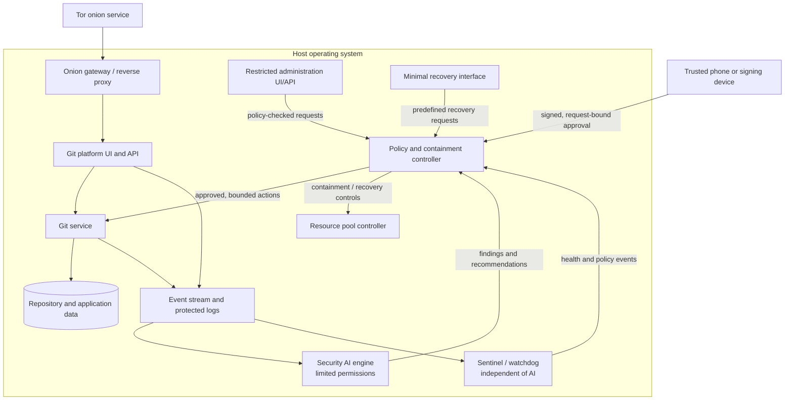
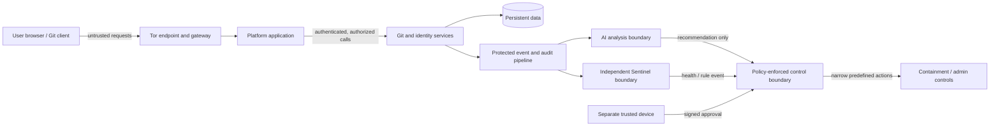
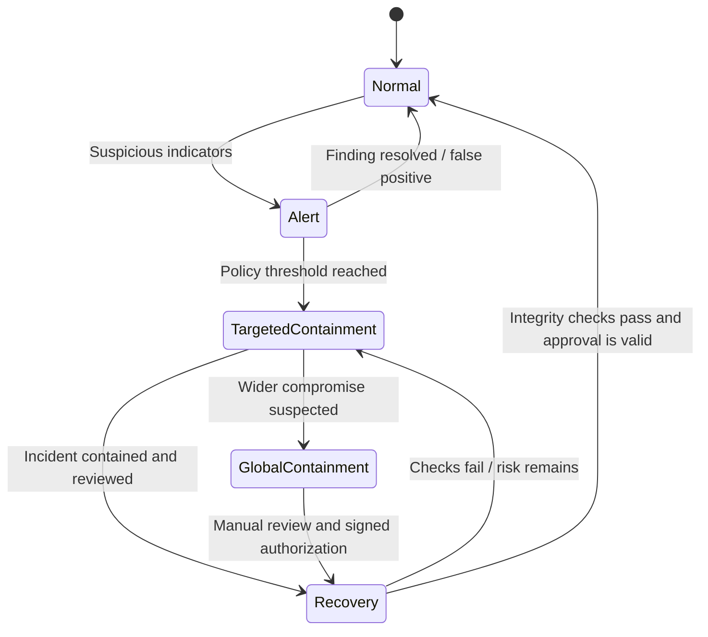
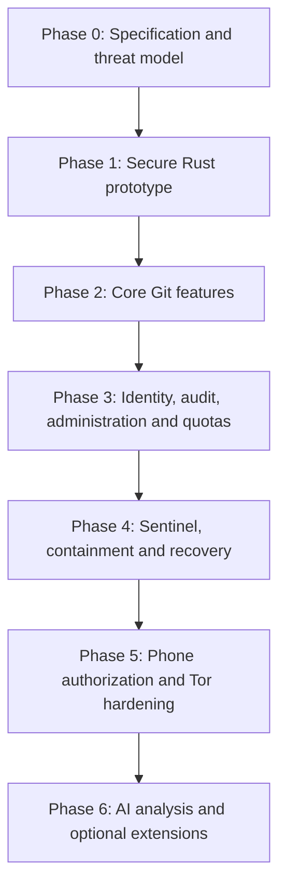

# Private and Secure Git Platform

> **Status:** Initial design — architecture and technical choices remain subject to validation.  
> **Primary language:** Rust  
> **Web UI candidate:** Leptos  
> **Initial deployment target:** One machine with 64 GB RAM  
> **Planned private access:** Tor onion service  
> **Scope:** Private Git hosting, administration, independent supervision, and recoverable security controls.

This project aims to build a private source-code hosting platform inspired by modern Git platforms. It prioritizes security boundaries, efficient resource use, maintainability, transparent administration, and reliable recovery. Rust is the default implementation language wherever practical.

**This repository describes a proposed design. It does not imply that every listed component has been implemented or security-reviewed.** Components and directories should be added incrementally as requirements become clear; avoid empty placeholders and premature service fragmentation.

## Contents

- [Project goals](#project-goals)
- [Guiding principles](#guiding-principles)
- [Planned features](#planned-features)
- [Architecture overview](#architecture-overview)
- [Trust boundaries](#trust-boundaries)
- [Security AI and Sentinel](#security-ai-and-sentinel)
- [Containment and recovery](#containment-and-recovery)
- [Phone-based authorization](#phone-based-authorization)
- [Technology choices](#technology-choices)
- [Repository layout](#repository-layout)
- [Resource planning](#resource-planning)
- [Tor, persistence, and host operating system](#tor-persistence-and-host-operating-system)
- [Security and threat model](#security-and-threat-model)
- [Development approach](#development-approach)
- [Roadmap](#roadmap)
- [Initial acceptance criteria](#initial-acceptance-criteria)
- [Open decisions](#open-decisions)
- [Contributing and security reports](#contributing-and-security-reports)

## Project goals

The platform is intended to bring together:

- Private Git repository hosting and browsing.
- Commit, branch, tag, diff, issue, pull-request, and release management.
- Account, organization, permission, SSH-key, signing-key, and session management.
- A dynamic web interface and a separate restricted administration interface.
- A minimal recovery interface that does not depend on the main frontend or the AI engine.
- Security-event analysis and anomaly detection through an isolated AI service.
- An independent supervisor/watchdog and deterministic containment policies.
- Phone-signed approval for defined sensitive operations.
- Resource pools and explicit CPU, memory, and storage limits.
- Possible future VPN and crypto-wallet modules, each subject to a separate specification.

The first milestone is a small, functional, testable foundation. Advanced automation, code execution, VPN functionality, and wallet features must not be added before their security and operational requirements have been reviewed.

## Guiding principles

1. **Rust first.** Use Rust for backend services and project-specific logic wherever practical.
2. **Use reviewed security primitives.** Do not rewrite cryptographic algorithms, protocols, or other critical low-level mechanisms merely to avoid dependencies.
3. **Least privilege.** The public website, administration API, AI engine, Sentinel, containment controller, and recovery interface must not share unrestricted administrator access.
4. **AI is advisory, not sovereign.** The AI can analyze events, explain findings, and recommend or request narrowly defined actions. Deterministic policies and explicit permissions govern critical operations.
5. **Independent supervision.** The AI must not be able to disable Sentinel, expand its own privileges, or rewrite its own security policy.
6. **Human authorization for critical actions.** Sensitive operations require explicit authorization, with a phone signature where the policy specifies it.
7. **Recoverability by design.** The recovery path and essential logging must remain available in tested incident scenarios.
8. **Tor-aware design.** Minimize external requests, unnecessary third-party assets, IP leaks, and metadata exposure.
9. **Incremental scalability.** Begin on one host with strict logical and operating-system boundaries; preserve the option to move selected services to separate machines later.
10. **Auditable administration.** Privileged actions, approvals, and containment transitions must produce protected audit records.
11. **Secure defaults.** Repository code must not execute on the host. CI runners and webhooks remain disabled until their isolation model has been designed and tested.
12. **No absolute-security claims.** Security guarantees must be specific, testable, and reviewed as the system evolves.

## Planned features

| Area | Initial direction | Status |
|---|---|---|
| Git repositories | Create, browse, authorize, and manage repositories | Planned |
| Git history | Commits, branches, tags, and diffs | Planned |
| Accounts and sessions | Authentication, permissions, keys, and sessions | Planned |
| Public platform UI | Rust + Leptos candidate | To validate |
| Administration UI | Separate restricted dashboard | Planned |
| Recovery UI | Minimal interface for predefined recovery actions | Planned |
| Audit | Structured, protected audit events | Planned |
| Resource control | Explicit service quotas and monitoring | Planned |
| Security AI | Analyze authorized event streams with limited permissions | Planned |
| Sentinel | Independent health checks and deterministic policy | Planned |
| Phone authorization | Verify signed, action-bound approvals | Planned |
| Tor | Onion-service access in a test environment first | Planned |
| Issues, pull requests, releases | Add after the core Git workflow | Later milestone |
| CI/CD execution | Isolated runners only after a separate design review | Out of initial scope |
| VPN and crypto wallet | Separate requirements and threat models required | Undecided |

## Architecture overview

The first deployment is planned for a single machine. Components should still have distinct responsibilities, service identities, permissions, and communication interfaces. A single host does not provide the same isolation as separate machines; operating-system controls and, where warranted, stronger sandboxing are still required.



*Conceptual diagram only.* The exact processes, protocols, service boundaries, data formats, and failure behavior must be specified before production deployment. The diagram does not mean the AI directly controls privileged host operations: requests must pass through a policy-enforcing component with narrowly scoped permissions.

### Main components

- **Onion gateway:** exposes the intended service through Tor and forwards only to explicitly configured internal endpoints.
- **Git platform UI/API:** provides the user-facing application and validates requests. It must not expose arbitrary shell commands.
- **Git service and storage:** manages repository operations and persistent repository data. Repository content is untrusted input.
- **Identity and authorization:** verifies users, sessions, keys, roles, and permissions. Authorization is enforced server-side, not merely in the UI.
- **Event and audit pipeline:** records security-relevant events and provides authorized read access to monitoring components.
- **Security AI:** analyzes permitted event data and produces findings or recommendations. It does not hold general root access or signing keys.
- **Sentinel:** independently monitors critical service health, supervision integrity, and defined security conditions.
- **Policy/containment controller:** enforces deterministic rules and executes only predefined, permitted operations.
- **Administration interface:** presents infrastructure status and offers narrow, policy-checked administrative actions.
- **Recovery interface:** provides a small set of predefined operations even when the main UI or AI is unavailable.
- **Resource controller:** applies configured CPU, memory, and storage limits. Quotas reduce resource-exhaustion risk but do not replace access controls.
- **Trusted phone:** signs sensitive requests on a separate device; private signing keys are not sent to the server.

## Trust boundaries



Treat the following as untrusted or potentially compromised: client requests, repository contents, uploaded artifacts, AI output, third-party dependencies, and any service that has not been independently verified. A service must not gain authority merely because another service recommends an action.

Interfaces between components should define:

- the identity of the caller and the permissions required;
- allowed request types and validated parameters;
- timeouts, rate limits, and failure behavior;
- event and schema versions;
- how requests are authenticated and protected against replay;
- which component records the decision and its outcome.

## Security AI and Sentinel

### Security AI

The AI may analyze authorized events concerning:

- Git operations and permission changes;
- authentication attempts, sessions, and privileged actions;
- process and service health;
- CPU, memory, and storage usage;
- network and Tor/VPN status;
- configuration changes and security logs;
- Sentinel and containment events.

Potential outputs include alerts, explanations, requests for human approval, repository/artifact quarantine recommendations, or requests to block a specific operation. Any action must be constrained by an explicit policy and implemented by a separate component.

**The AI must not, by itself:**

- stop, disable, or reconfigure Sentinel;
- modify its own permissions or policy;
- grant itself additional privileges;
- erase or rewrite audit records;
- authorize financial transactions or sign approvals;
- independently release critical containment.

### Sentinel / watchdog

Sentinel independently checks, as defined by policy:

- critical service availability and integrity;
- attempts to disable monitoring or alter protected policy;
- conditions that trigger containment;
- recovery-channel availability;
- transitions between normal operation, incident, and recovery states.

Sentinel should remain small, have minimal permissions, and use controlled startup and recovery procedures. The AI must not control Sentinel's lifecycle. Sentinel's own failure behavior and recovery path must also be documented and tested.

## Containment and recovery

Containment should be proportional and targeted. **Do not blindly freeze every process:** doing so may disable logging, the watchdog, or the only available recovery channel.

### Proposed incident state machine



| State | Intended behavior |
|---|---|
| **Normal** | Authorized services operate under configured controls. |
| **Alert** | Increase relevant monitoring, preserve evidence, and notify the operator. |
| **Targeted containment** | Isolate the specific service, repository, artifact, or operation implicated by the incident. |
| **Global containment** | Suspend or restrict non-essential services according to a tested allowlist. |
| **Recovery** | Verify integrity and restore services gradually under explicit authorization. |

The allowlist of essential components should preserve the operating system, Sentinel/watchdog, emergency administration path, and essential logging where feasible. Recovery must not depend solely on a component that may be compromised in the same incident.

Critical containment release requires a signed, manual approval bound to the operator identity, exact action and parameters, and incident ID. The approval must expire and be protected against replay. AI output alone is never sufficient to exit critical containment.

## Phone-based authorization

A trusted phone or separate signing device is intended to authorize selected sensitive operations.

- Private signing keys remain on the device and are never transmitted to the server.
- The device displays the operation, target, parameters, and incident ID before approval.
- The signature is bound to the exact request, not a generic “approve” flag.
- Requests have unique identifiers, expiration, and replay protection.
- Approvals, denials, and execution results are audited.
- If the device is unavailable, new privileged operations are denied or deferred according to policy; routine pre-authorized services may continue.
- Loss, replacement, and re-enrollment procedures must be designed before production. There must be no undocumented backdoor.

Operations that may require phone approval include security-policy changes, privileged updates, sensitive maintenance, administrative-key changes, critical containment release, and defined financial operations.

## Technology choices

| Area | Current candidate or rule | Decision status |
|---|---|---|
| Backend and custom logic | Rust | Target |
| Web interface | Leptos, Rust, HTML/CSS | Proposed; validate with a prototype |
| Animation | CSS first | Proposed |
| Internal API | Rust API with strict authentication and authorization | To design |
| Real-time updates | WebSocket only where necessary | To design |
| Version control | Git | Target |
| Private remote access | Tor onion service | Target; configuration pending |
| Database | Not selected | Open |
| Repository storage | Dedicated persistent storage | To design |
| Isolation | Separate service identities and environments; stronger sandboxing where needed | To design |
| Security AI | Isolated service with minimal permissions | Target |
| Supervision | Independent Sentinel/watchdog | Target |
| Approval | Phone-based signed authorization for defined actions | Target |
| CI/CD | Isolated runners only after separate threat modelling | Deferred |
| VPN | Separate module and threat model | Undecided |
| Crypto wallet | Model and scope must be clarified | Undecided |

Exact versions, dependencies, cryptographic algorithms, schemas, and service interfaces will be selected after a design review. Use reviewed cryptographic libraries behind narrow interfaces rather than implementing production cryptography from scratch.

## Repository layout

The following is a proposed starting layout, not a requirement to create every directory immediately.

```text
private-git-platform/
├── README.md
├── DIRECTORY_STRUCTURE.md
├── LICENSE
├── CONTRIBUTING.md
├── SECURITY.md
├── .gitignore
├── rust-toolchain.toml
├── Cargo.toml
├── Cargo.lock
├── docs/
│   ├── architecture/
│   │   ├── overview.md
│   │   ├── trust-boundaries.md
│   │   ├── service-interfaces.md
│   │   ├── resource-pools.md
│   │   └── data-flows.md
│   ├── security/
│   │   ├── threat-model.md
│   │   ├── permissions.md
│   │   ├── incident-response.md
│   │   ├── containment-policy.md
│   │   └── phone-authorization.md
│   ├── operations/
│   │   ├── installation.md
│   │   ├── configuration.md
│   │   ├── backups-and-restore.md
│   │   ├── updates-and-rollback.md
│   │   └── recovery-runbook.md
│   └── decisions/
│       ├── README.md
│       └── 0001-rust-first.md
├── apps/
│   ├── platform-ui/
│   ├── admin-ui/
│   └── recovery-ui/
├── services/
│   ├── git-service/
│   ├── api-gateway/
│   ├── identity-service/
│   ├── admin-service/
│   ├── resource-controller/
│   ├── security-ai/
│   ├── sentinel/
│   ├── containment-controller/
│   ├── phone-authorization/
│   └── audit-service/
├── crates/
│   ├── domain/
│   ├── config/
│   ├── api-types/
│   ├── authz/
│   ├── crypto-boundaries/
│   ├── event-types/
│   ├── observability/
│   ├── storage/
│   └── test-support/
├── migrations/
├── config/
│   ├── examples/
│   └── policies/
├── deploy/
│   ├── tor/
│   ├── service-units/
│   ├── host-hardening/
│   └── local-dev/
├── scripts/
├── tests/
│   ├── integration/
│   ├── security/
│   ├── containment/
│   ├── recovery/
│   └── fixtures/
├── tools/
│   ├── audit-inspector/
│   └── dev-cli/
└── .github/
    ├── workflows/
    ├── ISSUE_TEMPLATE/
    └── PULL_REQUEST_TEMPLATE.md
```

### Directory responsibilities

- **`apps/`** — user-facing applications. Keep the public platform, infrastructure dashboard, and recovery UI separate. The recovery UI should have a smaller dependency and permission footprint than the main site.
- **`services/`** — backend responsibilities. A directory does not automatically need to become a separate process on day one. Split processes where security boundaries, fault isolation, or operational needs justify it.
- **`crates/`** — shared Rust libraries. Keep dependency direction clear, avoid circular dependencies, and prevent shared libraries from depending on application binaries.
- **`docs/`** — architecture, threat model, operating procedures, and recorded decisions. Update these documents when a trust boundary or operational behavior changes.
- **`config/`** — safe examples and policy templates only. Never commit production secrets, private keys, real onion credentials, tokens, or recovery codes.
- **`deploy/`** — deployment templates and host-hardening guidance. Example configurations are not production-ready by default.
- **`tests/`** — integration, security, containment, and recovery tests. Run containment tests in a controlled environment and verify that recovery and audit logging remain available.
- **`migrations/`** — versioned database schema changes, once a database is selected.
- **`.github/`** — CI workflows and contribution templates. Do not add workflows that deploy to a real host until their permissions and secret handling have been reviewed.

The root `Cargo.toml` should list only workspace members that actually exist. Add crates and applications incrementally rather than creating every placeholder at the start.

## Resource planning

The initial host is expected to have 64 GB of RAM. That capacity alone does not establish that all planned services can run together reliably.

Measure and define:

- memory reserved for the operating system, Sentinel, and recovery;
- CPU and memory ceilings for each service;
- storage budgets for repositories, database data, logs, and backups;
- maximum request and event rates;
- behavior when memory, CPU, disk, or file descriptors are exhausted;
- how much resource capacity remains available for incident response.

The resource controller enforces configured limits and emits monitoring events. It is not a substitute for operating-system access controls, sandboxing, or process isolation. Limits must leave enough capacity for essential supervision and recovery.

## Tor, persistence, and host operating system

The site is intended to be reachable through a Tor onion service. The deployment should minimize IP leaks, unnecessary external requests, third-party frontend assets, and avoidable metadata. Tor configuration and network behavior must be tested rather than assumed secure by design alone.

The host operating system has not been selected. **Tails is primarily designed for temporary, privacy-focused use, not as a conventional always-on persistent server OS.** It may be useful for targeted experiments, but a permanent service needs a deliberate plan for persistent storage, availability, updates, and recovery. A maintained, hardened server OS may be more appropriate.

Before public deployment, define and test:

- persistent data layout and filesystem permissions;
- encryption-at-rest requirements and key handling;
- encrypted backups stored separately from the primary data;
- restoration procedures and recovery credentials;
- update verification, rollback, and maintenance windows;
- onion-service configuration and network exposure;
- incident response if the host itself is compromised.

## Security and threat model

The threat model must identify adversaries, assets, trust boundaries, and specific guarantees. At minimum, examine:

- compromised user accounts, sessions, SSH keys, or signing keys;
- malicious repository content and crafted uploads;
- frontend or API vulnerabilities;
- compromise of the AI engine or a dependency;
- resource exhaustion and denial of service;
- audit-log tampering;
- update and dependency supply-chain compromise;
- loss or compromise of the trusted phone;
- Tor, firewall, or future VPN misconfiguration;
- backup loss or failed restoration;
- compromise of the host operating system.

Controls to design and test include least privilege, separate service identities, strong authentication, short and revocable sessions, strict input validation, CSRF protection and origin checks where applicable, rate limits, quotas, verified updates, protected audit logs, encrypted backups, restoration drills, and security testing.

Repository contents are data, not trusted instructions. No repository code should execute directly on the host. If CI/CD is introduced later, runners need a separate sandbox, strict resource limits, constrained network access, and a distinct threat model.

## Development approach

Start with specification and tests before adding complex automation. Keep the initial implementation small enough to understand and audit.

Once a Rust workspace exists, the following are useful baseline checks:

```bash
cargo fmt --all -- --check
cargo clippy --workspace --all-targets -- -D warnings
cargo test --workspace
```

Run these commands against implemented workspace members. Add dependency auditing and software-supply-chain checks to CI after the dependency policy is established. Do not commit secrets or production configuration to the repository.

### Suggested implementation order

1. Define the MVP, trust boundaries, roles, permissions, and threat model.
2. Choose the host OS, storage approach, backup plan, and database.
3. Create the root Cargo workspace and only the initial shared crates that are needed.
4. Implement and test core Git repository operations.
5. Build the first platform UI and server-side authorization.
6. Add identity/session management and protected audit logging.
7. Add the administration dashboard and resource limits.
8. Implement phone authorization and the minimal recovery interface.
9. Build Sentinel and containment controls; test them without depending on AI.
10. Add the security AI initially with read-only access to authorized event data.
11. Configure Tor in a test environment; test leaks, backups, updates, restoration, and incident procedures.
12. Perform an independent security review before real-world exposure.

## Roadmap



| Phase | Main outcome |
|---|---|
| **0 — Specification** | Requirements, threat model, roles, trust boundaries, OS/storage/database decisions, and Leptos prototype decision. |
| **1 — Secure prototype** | Rust workspace, project conventions, tests, formatting/linting, initial interface, and verified service boundaries. |
| **2 — Git features** | Repository management, commit/branch/tag/diff views, and permission checks. |
| **3 — Administration and resources** | Identity, audit, dashboard, metrics, quotas, alerts, and resource-exhaustion tests. |
| **4 — Security and recovery** | Sentinel, containment state machine, recovery UI, and tested restoration procedures. |
| **5 — Tor and hardening** | Phone-signed approvals, onion-service test deployment, leak checks, backup/restore drills, and security review. |
| **6 — AI and extensions** | Incremental AI analysis with constrained permissions; consider isolated runners, VPN, or wallet only after dedicated designs. |

## Initial acceptance criteria

The first version is ready for real-world testing only when:

- permissions and trust boundaries are documented for every service;
- repository content cannot execute arbitrary code on the host;
- the AI cannot disable Sentinel or rewrite its own permissions;
- privileged operations are authorized server-side;
- phone signatures are bound to an exact request and protected against replay;
- critical containment release requires explicit authorization;
- recovery remains available in tested incident scenarios;
- backup restoration has been demonstrated;
- resource limits prevent one service from monopolizing the host;
- audit logs are protected from ordinary users and monitored services;
- Tor exposure and unintended network paths have been tested;
- known limitations, unresolved risks, and incident procedures are documented.

Passing these criteria does not prove absolute security. It establishes a baseline for controlled testing and further review.

## Open decisions

- Final project name and onion address.
- Host operating system and hardening baseline.
- Leptos validation and final frontend approach.
- Database and repository/data storage design.
- Backup, encryption, and key-management strategy.
- Service boundaries and internal API protocols.
- Phone approval policy and lost-device recovery procedure.
- Exact AI capabilities and permitted actions.
- Containment thresholds, allowlist, and release procedure.
- Whether CI/CD execution is required.
- Whether a VPN is needed and how it interacts with Tor.
- Whether a crypto wallet is needed and which model it would use.
- Resource budgets based on measurements rather than estimates.

## Contributing and security reports

Contribution rules and the security-reporting process should be documented in `CONTRIBUTING.md` and `SECURITY.md` before accepting external contributions or deploying the platform. Do not include secrets, live onion-service credentials, private keys, or sensitive incident evidence in public issues or commits.

Until the implementation and security review are complete, treat this project as an evolving design and development effort—not as a production-ready secure hosting service.

## Final principle

The objective is not simply to build a Git platform in Rust. It is to create a **modular, auditable, and recoverable system** in which AI improves visibility and defensive capabilities without becoming an uncontrolled authority. Build a functional, testable foundation first, then add advanced capabilities incrementally without weakening the security boundaries.
